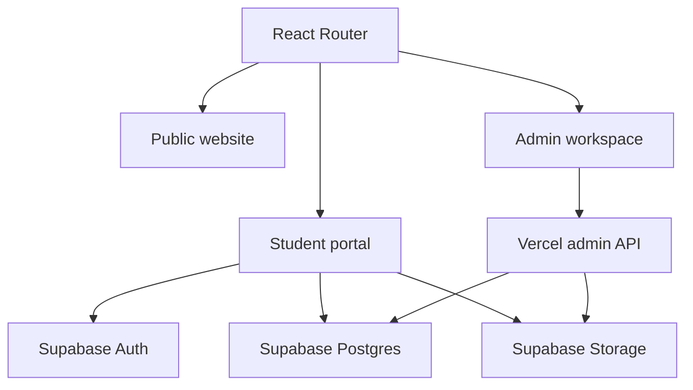

<div align="center">

# NorthBridge Education

**One workspace for study-abroad candidates and the team supporting their applications.**

[Public site](https://north-bridge-education.vercel.app/home-page) · [Student portal](https://north-bridge-education.vercel.app/portal/login) · [Admin workspace](https://north-bridge-education.vercel.app/login)

</div>

## What’s inside

| Area | Entry point | Workflow |
| --- | --- | --- |
| Public website | `/home-page`, `/get-started` | Study-abroad landing page and enquiry form. The root route `/` shows the coming-soon page. |
| Student portal | `/portal/login` → `/portal/profile` | Sign in, manage candidate information, browse programs, apply, and upload documents. |
| Admin workspace | `/login` → `/app` | Manage candidates, review and approve drafts, and browse submitted files from `/app/files`. |

## Tech stack

| Layer | Technology |
| --- | --- |
| Frontend | React 19, TypeScript, Vite, React Router |
| UI | Tailwind CSS 4, shadcn/ui, Radix UI, Lucide |
| Data and identity | Supabase Postgres, Row Level Security (RLS), Supabase Auth with Google |
| Documents | Supabase Storage and Postgres file metadata |
| Admin API | Vercel Node.js Functions, signed HTTP-only session cookie |
| Tooling and hosting | Bun, ESLint, Prettier, Vercel, Vite PWA |

## Local setup

Install Bun and a recent Node.js LTS release for Vite and the Vercel CLI. Use a development Supabase project with the application schema already provisioned.

```bash
git clone https://github.com/NorthBridgeEducation/NorthBridgeEducation.git
cd NorthBridgeEducation
bun install
```

Create **`.env.local`** in the repository root. Replace each placeholder with a development value.

```dotenv
VITE_SUPABASE_URL=https://YOUR_PROJECT_REF.supabase.co
VITE_SUPABASE_PUBLISHABLE_KEY=YOUR_SUPABASE_PUBLISHABLE_KEY

SUPABASE_URL=https://YOUR_PROJECT_REF.supabase.co
SUPABASE_SECRET_KEY=YOUR_SUPABASE_SECRET_KEY
ADMIN_DEMO_EMAIL=YOUR_ADMIN_EMAIL
ADMIN_DEMO_PASSWORD=YOUR_ADMIN_PASSWORD
ADMIN_SESSION_SECRET=YOUR_RANDOM_SECRET_AT_LEAST_32_CHARACTERS
```

Use the Supabase project's API URL and keys. The `VITE_` values are bundled into the browser app. Keep the Supabase secret key and admin credentials in the server environment. Generate a random session secret with `node -e "console.log(require('node:crypto').randomBytes(32).toString('hex'))"`.

### Run the frontend and API

```bash
bunx vercel dev --listen 3000
```

Run this from the repository root to serve the app with its Vercel Functions. Link the checkout to the Vercel project if prompted, then open `http://localhost:3000`. For frontend-only work, use `bun run dev` and open `http://localhost:5173`. Vite forwards `/api` requests to port 3000, so admin actions from that URL require the API server. [Vercel CLI reference](https://vercel.com/docs/cli/dev)

| Command | Purpose |
| --- | --- |
| `bun run build` | Run the TypeScript build and generate `dist/`. |
| `bun run lint` | Run ESLint. |
| `bun run preview` | Preview the built frontend. Use Vercel dev to exercise the admin API. |

### Configure Supabase and Google

1. Provision the project schema, including `candidates`, `candidate_education`, `candidate_language_tests`, `draft`, `countries`, `universities`, and `programs`. Program applications use `program_applications`. Draft approval calls the `approve_candidate_draft(p_draft_id)` database function. A fresh Supabase project needs these database objects before the workflows can run.
2. Provision the `files` metadata table, `available_files` view and private `files` Storage bucket. Configure the database and Storage policies so students can access their own records and documents.
3. In Supabase **Authentication → Providers**, enable Google using your Google OAuth client ID and secret. In Google Cloud, use the callback URL displayed by Supabase for that project as the authorized redirect URI.
4. In Supabase **Authentication → URL Configuration**, set the Site URL to your deployed origin. Add the exact app callback for every origin you use, such as `http://localhost:5173/portal/profile`, `http://localhost:3000/portal/profile`, and `https://north-bridge-education.vercel.app/portal/profile`. The app constructs this callback from the current browser origin.

## Architecture



The student portal uses the publishable key with the student's Supabase session. Candidate access is scoped through `candidates.auth_user_id` and RLS. Education and language-test records belong to a candidate through `candidate_id`. Student uploads reserve a metadata row in `files`, upload the object to Storage, and read available documents through `available_files`.

The admin workspace signs in through `/api/admin/login`. Protected admin handlers validate the signed session cookie before using the server-side Supabase key. Admin draft approval writes through a database RPC. Admin file browsing and download requests go through `/api/admin/files`.

| Path | Responsibility |
| --- | --- |
| [`src/app/router/routes.tsx`](src/app/router/routes.tsx) | Public, student, and protected admin routes |
| [`src/modules/public/`](src/modules/public/) | Public landing page and coming-soon page |
| [`src/modules/candidate/`](src/modules/candidate/) | Candidate screens and draft review |
| [`src/modules/files/`](src/modules/files/) | Admin file browsing |
| [`src/portal/`](src/portal/) | Student layout, route protection, and pages |
| [`src/lib/supabase/client.ts`](src/lib/supabase/client.ts) | Browser Supabase client |
| [`api/admin/`](api/admin/) | Admin session, candidate, draft, and file endpoints |

## Deploy to Vercel

1. Import the GitHub repository into Vercel. Use the repository root, the Vite preset, `bun run build`, and the `dist` output directory.
2. Add the environment variables above under **Project Settings → Environment Variables** for each Vercel environment you use, then deploy.
3. If deploying to `northbridgeeducation.com`, add it under **Vercel → Domains**, apply the DNS records Vercel provides in Cloudflare, and add `https://northbridgeeducation.com/portal/profile` to the Supabase redirect allowlist.
4. Check a direct visit to `/portal/profile`, admin sign-in at `/login`, and a Google sign-in round trip. Verify a student upload appears in their documents and an authorized admin can find it under **Files**.

## Roadmap

| Priority | Planned work |
| --- | --- |
| 1 · Candidate files | Add admin uploads and a searchable candidate folder grid under **Files**. Open a candidate card to see that candidate's documents and download links. |
| 2 · Program catalogue | Complete the admin workflow for countries, universities, and programs, then verify the catalogue and application flow from the student portal. |
| 3 · Candidate onboarding | Verify candidate linking on Google sign-in and admin email changes. Cover new users, existing candidates, and reassigned email addresses. |
| 4 · Reproducible setup | Record the required database objects, approval RPC, RLS and Storage policies in versioned migrations and add a sample environment file. |

